# Preparación del entorno de trabajo en Python

Clase 18 · Clases y objetos

- Alumno: Álvaro García-Quismondo Lizana
- Asignatura: Python para Big Data Engineering
- Repositorio: github.com/alvarophck/repo-del-master
- Fecha: 28 de octubre de 2026

## 1. Objetivo

En este documento recojo los pasos que seguí para dejar preparado el entorno de trabajo de las clases de Python: repositorio del máster clonado en local, carpeta común python_big_data_engineering con un único entorno virtual, archivos de configuración y primer envío al repositorio remoto de GitHub. Cada paso va acompañado de la captura que lo documenta.

## 2. Entorno de trabajo

| Componente | Detalle |
|---|---|
| Sistema operativo | Windows 11 |
| Python | 3.12.10 |
| Git | 2.56.0.windows.3 |
| Editor | Visual Studio Code con la extensión Python de Microsoft |
| Terminal | PowerShell integrada en VS Code |
| Repositorio remoto | https://github.com/alvarophck/repo-del-master |
| Ruta local | C:\Users\alvar\Documents\repo-del-master |

## 3. Comprobación de herramientas

Comprobé las versiones de Python y Git desde PowerShell. En la primera ejecución de py -3.12 el lanzador descargó e instaló Python 3.12.10 y a continuación mostró la versión. Las variables user.name y user.email de Git estaban vacías, así que las configuré y las volví a consultar.

```powershell
py -3.12 --version
git --version
git config --global user.name "alvarophck"
git config --global user.email "alvarophck@gmail.com"
```

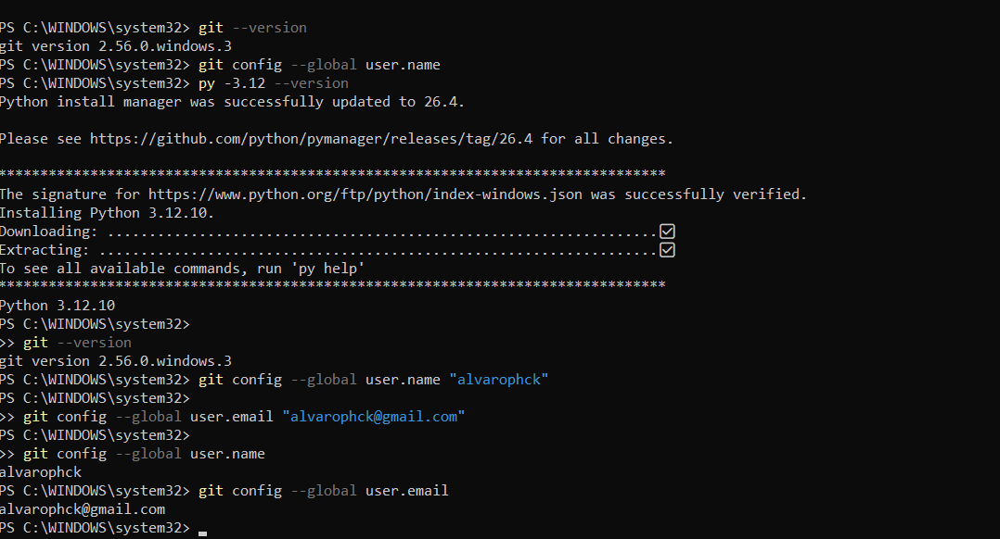

*Figura 1. Versiones de Python y Git y configuración de la identidad de Git.*

## 4. Clonado del repositorio

El repositorio del máster se había creado en GitHub y estaba vacío. Lo cloné desde la carpeta Documentos y comprobé el remoto y el estado de la rama. Git avisó de que se había clonado un repositorio vacío y git status mostró la rama main sin commits.

```powershell
cd $HOME\Documents
git clone https://github.com/alvarophck/repo-del-master.git
cd repo-del-master
git remote -v
git status
```

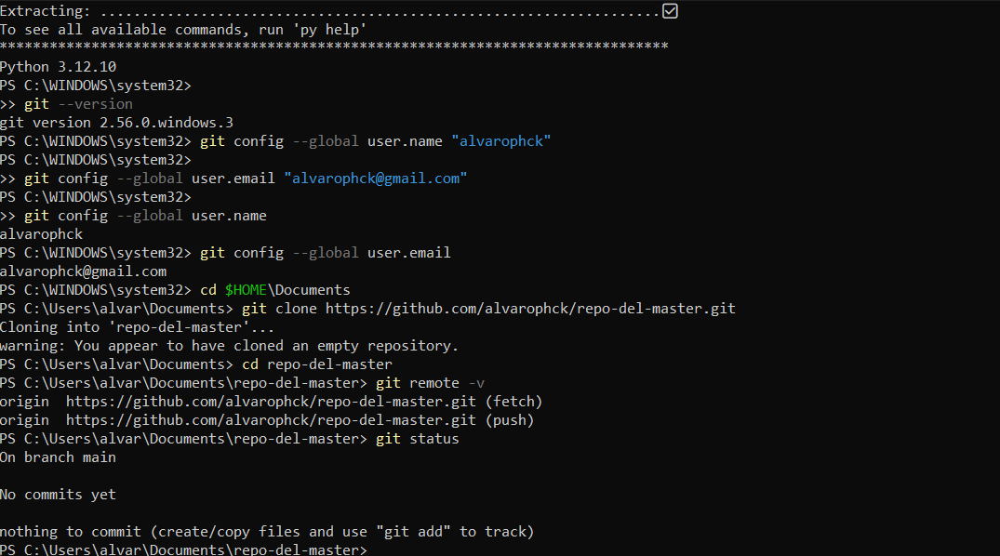

*Figura 2. Clonado del repositorio vacío y comprobación del remoto origin.*

## 5. Carpeta común de Python

Dentro del repositorio creé la carpeta python_big_data_engineering, que reunirá todas las clases de Python, y la abrí en VS Code. Después, desde la terminal integrada y con la ruta completa, creé la subcarpeta .vscode.

```powershell
mkdir python_big_data_engineering
code python_big_data_engineering
```

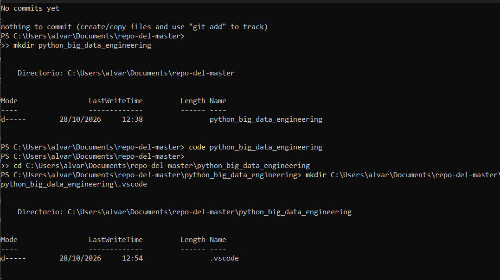

*Figura 3. Creación de la carpeta python_big_data_engineering y de la subcarpeta .vscode.*

## 6. Entorno virtual

Con la terminal situada en la carpeta común creé el entorno virtual con Python 3.12 y lo activé; el prompt pasó a empezar por (.venv). Comprobé la versión y actualicé pip de 25.0.1 a 26.2.2.

```powershell
cd C:\Users\alvar\Documents\repo-del-master\python_big_data_engineering
py -3.12 -m venv .venv
.venv\Scripts\Activate.ps1
python --version
python -m pip install --upgrade pip
```

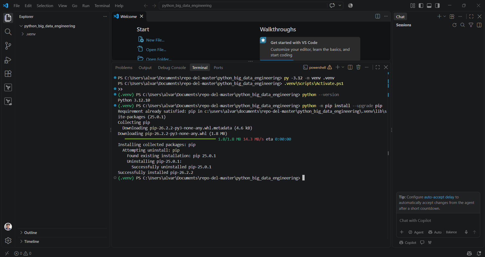

*Figura 4. Creación y activación del entorno virtual y actualización de pip.*

## 7. Selección del intérprete

El comando Python: Select Interpreter no aparecía en la paleta de comandos de VS Code, porque faltaba la extensión Python de Microsoft. La instalé desde el panel de extensiones, volví a la paleta y seleccioné el intérprete del entorno virtual. La barra de estado muestra a continuación el intérprete .venv con Python 3.12.10.

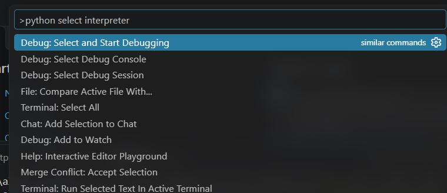

*Figura 5. Paleta de comandos sin el comando de selección de intérprete, antes de instalar la extensión.*

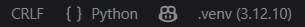

*Figura 6. Barra de estado de VS Code con el intérprete .venv (3.12.10) seleccionado.*

## 8. Archivos de configuración

En la carpeta común creé los archivos que se indican a continuación, antes del primer commit para que .venv no llegara a subirse. El contenido completo de cada uno está en la carpeta archivos_config del paquete de entrega.

| Archivo | Función |
|---|---|
| `requirements.txt` | Lista de dependencias externas. En esta clase solo se usa la biblioteca estándar. |
| `.gitignore` | Excluye .venv, cachés de Python, .env, archivos de Windows y la configuración personal de VS Code, salvo settings.json. |
| `.vscode/settings.json` | Abre PowerShell como terminal, activa el entorno en las terminales nuevas, ejecuta cada archivo desde su carpeta y guarda en UTF-8. |
| `README.md` | Índice de las clases de Python, con mi nombre como autor. |
| `clase_18_clases_objetos/README.md` | Lista de progreso de la clase. |

Contenido de requirements.txt:

```text
# Dependencias comunes de las clases de Python
# Clase 18: solo biblioteca estándar de Python, sin librerías externas
```

Contenido de .vscode/settings.json:

```json
{
    "terminal.integrated.defaultProfile.windows": "PowerShell",
    "python.terminal.activateEnvironment": true,
    "python.terminal.executeInFileDir": true,
    "files.encoding": "utf8"
}
```

Contenido de .gitignore:

```text
# Entorno virtual de Python
.venv/
venv/
env/

# Caché y compilados de Python
__pycache__/
*.pyc
*.pyo

# Variables de entorno y secretos
.env

# Archivos de sistema de Windows
Thumbs.db
ehthumbs.db
desktop.ini

# Configuración personal de VS Code (solo se comparte settings.json)
.vscode/*
!.vscode/settings.json
```

## 9. Estructura en VS Code

El Explorador de VS Code muestra la carpeta común con el entorno virtual, la carpeta .vscode, la carpeta de la clase y los tres archivos de la raíz.

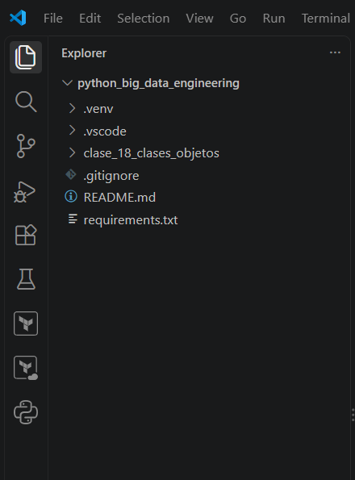

*Figura 7. Explorador de VS Code con la estructura de python_big_data_engineering.*

## 10. Primer commit

Añadí los archivos con git add . y revisé git status. Git avisó de que sustituirá los saltos de línea LF por CRLF la próxima vez que toque los archivos, algo habitual en Windows que no impide continuar. La lista de archivos preparados contiene los cinco esperados y no incluye .venv.

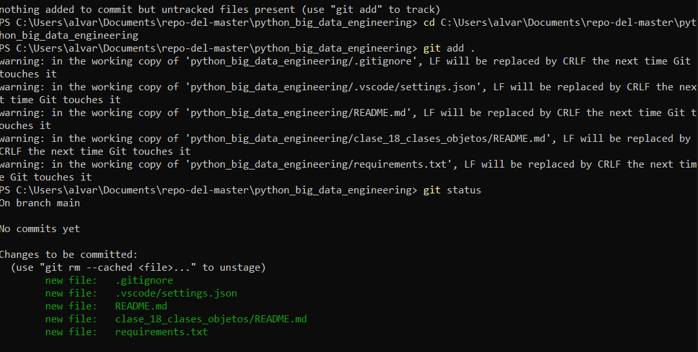

*Figura 8. Resultado de git add . y git status: cinco archivos nuevos y ninguno de .venv.*

Hice el commit, renombré la rama a main y envié los cambios con -u, porque el repositorio remoto estaba vacío y había que enlazar la rama local con origin/main. Git abrió el navegador para autenticarme en GitHub antes de completar el envío.

```powershell
cd C:\Users\alvar\Documents\repo-del-master\python_big_data_engineering
git add .
git commit -m "python: entorno común y estructura de la clase 18"
git branch -M main
git push -u origin main
```

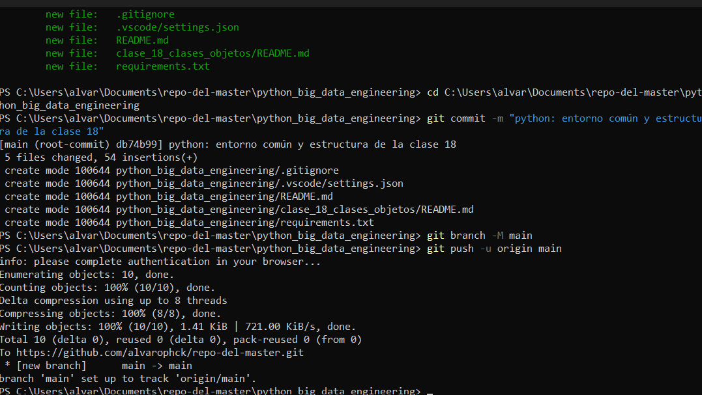

*Figura 9. Commit raíz db74b99 con cinco archivos y envío a origin/main.*

## 11. Verificación en GitHub

Tras recargar el repositorio, GitHub muestra el commit db74b99 en la rama main y la carpeta python_big_data_engineering. Dentro aparecen .vscode, clase_18_clases_objetos, .gitignore, README.md y requirements.txt, y no aparece .venv. El README de la carpeta se muestra con mi nombre como alumno.

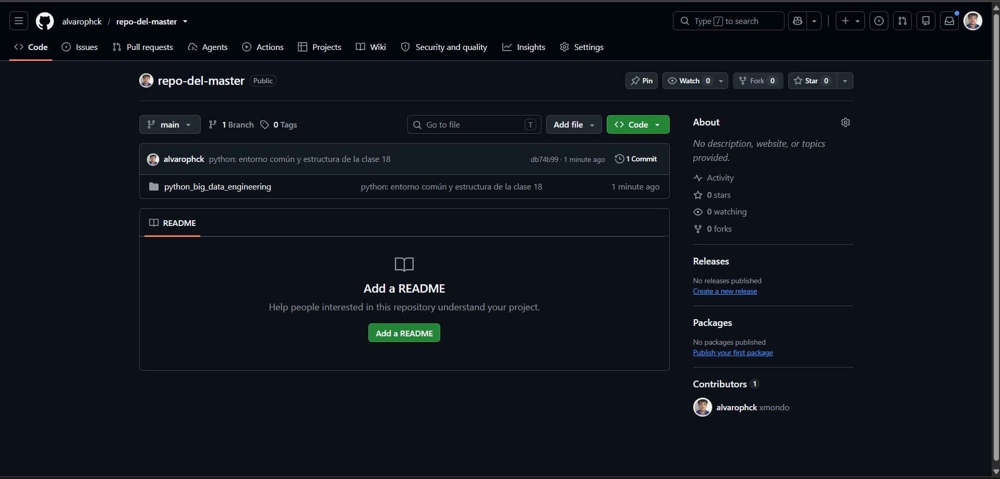

*Figura 10. Raíz del repositorio en GitHub tras el primer envío.*

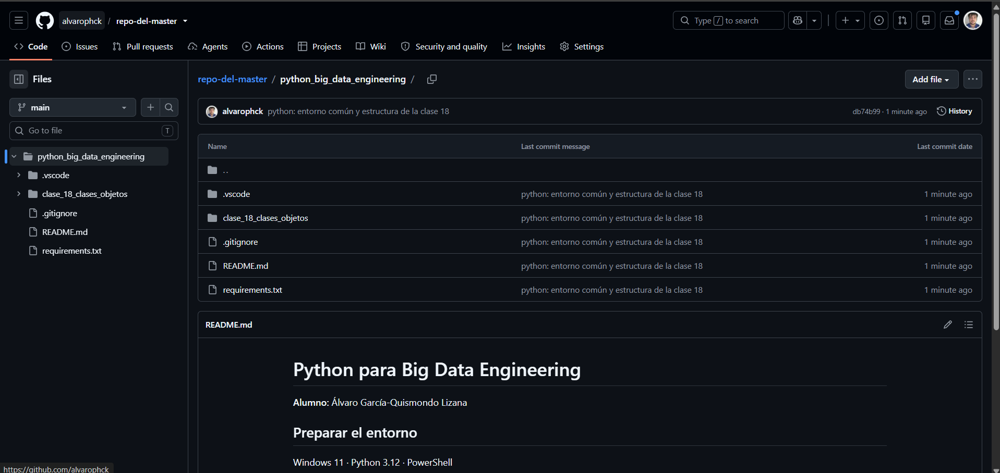

*Figura 11. Contenido de python_big_data_engineering en GitHub.*

## 12. Estado final

Estructura registrada en el repositorio tras el primer commit:

```text
repo-del-master/
+-- python_big_data_engineering/
    +-- .gitignore
    +-- README.md
    +-- requirements.txt
    +-- .vscode/
    |   +-- settings.json
    +-- .venv/                      (solo en local, no se sube)
    +-- clase_18_clases_objetos/
        +-- README.md
```

Los documentos .md de la clase y las subcarpetas teoria, ejercicios_basicos, ejercicios_intermedios, ejercicios_avanzados y caso_estudio se incorporarán en commits posteriores, ya que Git no registra carpetas vacías.
